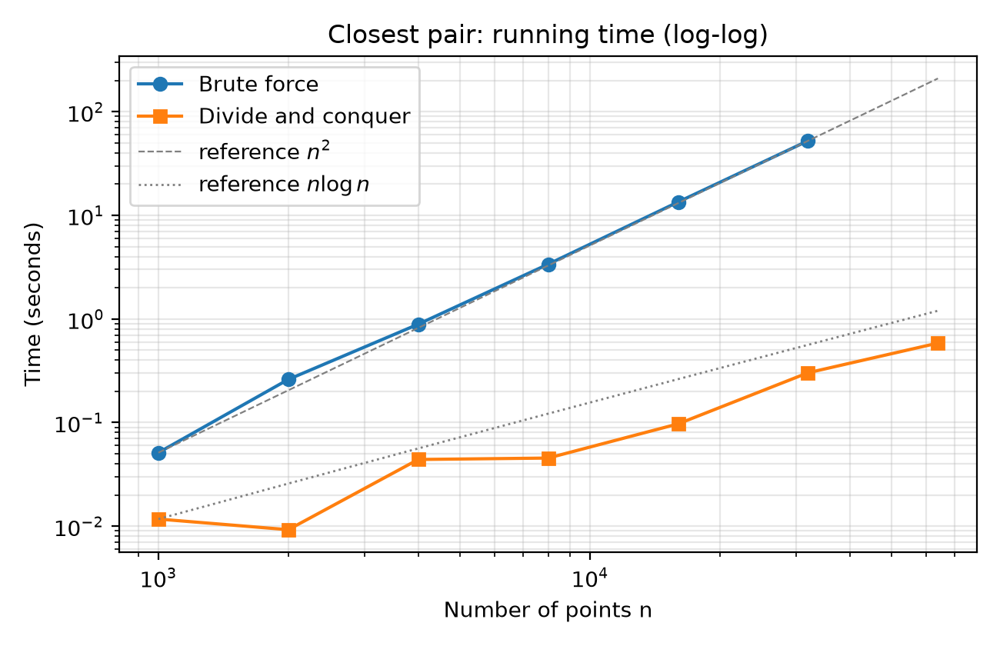

# Assignment 2: Closest Camera Traps — Report

**AI tool disclosure:** Claude (Anthropic) was used to draft `closest.py`, `test_closest.py`, `benchmark.py` and the first draft of this report. All code was run, and `closest_pair` was checked against `closest_pair_brute` on 2,000 random inputs plus the required edge cases (Part B). 

---

## 1. Approach (Part A)

- `closest_pair_brute`: compares all n(n−1)/2 pairs using squared distances, so Θ(n²).
- `closest_pair`:
  1. Sort the points by x once (O(n log n)), keeping original indices.
  2. Split at the middle and solve both halves recursively; base case n ≤ 3 uses brute force.
  3. Let δ be the smaller of the two half-answers. Only points within δ of the dividing line can form a closer pair, so build that strip, ordered by y.
  4. For each strip point, compare it only with following strip points whose y-difference is below δ. A packing argument shows at most 7 such neighbours exist, so this step is O(n).
  5. To keep step 4 linear, each recursive call returns its points sorted by y, built by **merging** the two halves (same idea as merge sort), instead of re-sorting the strip at every level.

## 2. Testing (Part B)

`test_closest.py` has 14 tests, all passing:

| Requirement | Test |
|---|---|
| ≥ 500 random inputs, 2–50 points | 1,000 integer-coordinate inputs (small range, so many ties and duplicates) + 1,000 float inputs, each compared with brute force |
| Exactly 2 points | `test_exactly_two_points`, plus reversed x-order |
| Duplicate points (answer 0) | `test_duplicate_points`, `test_all_duplicates` |
| All points on one vertical line | `test_all_on_vertical_line` (also horizontal line) |
| Closest pair across the dividing line | `test_closest_pair_straddles_dividing_line`, plus shuffled-input version |
| Extra | many points sharing the split x; input list not modified; fewer than 2 points raises `ValueError` |

Because several pairs can tie for the minimum, the tests compare the distance with brute force and separately check that the returned indices are valid and match that distance.

## 3. Analysis (Part C)

### 3.1 Recurrence and Master Method

Let T(n) be the cost of the recursive part on n points (sorted by x already).

- Divide: find the middle, split lists: Θ(n) (slicing)
- Conquer: two subproblems of size n/2: 2T(n/2)
- Combine: merge by y, build strip, scan strip (constant work per strip point): Θ(n)

**T(n) = 2T(n/2) + Θ(n)**, with T(n) = Θ(1) for n ≤ 3.

Master Method: a = 2, b = 2, f(n) = Θ(n). Then n^(log_b a) = n^(log₂ 2) = n. Since f(n) = Θ(n^(log_b a)), this is **Case 2**, giving **T(n) = Θ(n log n)**.

The one-off initial sort by x is also Θ(n log n), so the total is **Θ(n log n)**.

### 3.2 Measured running times

Random points in a 100,000 × 100,000 square. Median of 3 runs (1 run for brute force at n ≥ 8,000). Python 3.13, 2-core cloud machine; your own machine will give different absolute numbers.

| n | Brute force (s) | Divide and conquer (s) | Speed-up |
|---:|---:|---:|---:|
| 1,000 | 0.0656 | 0.0044 | 15× |
| 2,000 | 0.2551 | 0.0092 | 28× |
| 4,000 | 1.2982 | 0.0273 | 48× |
| 8,000 | 4.5250 | 0.0472 | 96× |
| 16,000 | 19.2679 | 0.1144 | 168× |
| 32,000 | not run (predicted > 60 s) | 0.3545 | — |
| 64,000 | not run (predicted > 60 s) | 0.8627 | — |

Brute force at 16,000 took 19.3 s, so at 32,000 it would take roughly 4 × 19.3 ≈ 77 s, over the 60 s limit; it was therefore not started.

*Figure 1. Running time against n, both axes logarithmic. Dashed and dotted grey lines are n² and n log n reference curves anchored at n = 1,000.*

### 3.3 Crossover point

Both functions were timed (median of 60–200 repeats) for n = 4 to 400. Divide and conquer first becomes faster at **n ≈ 40** and stays faster for every tested n from 40 upward. Around 38 the two are within about 2% of each other, and individual readings in the 44–50 range are noisy, so treat the crossover as roughly **n ≈ 40 (±5) on this machine**. Raw data: `crossover.csv`.

## 4. Critical Reflection (Part D)

> **Word limit: 400.** The two answers below are drafts based on the measured results above. Rewrite them in your own words, and replace the third placeholder with your own experience. You may be asked about them in the viva.

**1. Did measured growth match the recurrence?** Mostly yes. Doubling n multiplied brute-force time by 3.5 to 5.1 (theory: 4), and the slope of the brute-force line on the log-log graph tracks the n² reference. For divide and conquer, doubling n multiplied time by about 1.7 to 3.1 against a predicted ×2.1 to ×2.2 for n log n. The spread comes from noise (only 3 repeats, shared cloud machine, Python garbage collection and memory effects on large lists); the 32,000 point sits a little above the n log n line. Overall the curve is far shallower than n² and close to n log n, which supports Θ(n log n). The brute-force runs at n ≥ 8,000 used a single repeat, so their ratios are the least reliable.

**2. Why is brute force faster for small n?** Big-O hides constant factors and lower-order terms. Brute force is a tight double loop with no allocation. Divide and conquer sorts, copies lists, recurses, merges and builds a strip, so each "step" costs far more. Below about n = 40 the n² pairs are so few that this overhead outweighs the saving; above it, the n log n growth wins and the gap widens quickly (168× by n = 16,000).

---

## 5. Files submitted

- `closest.py`: both implementations
- `test_closest.py`: 14 tests (`python test_closest.py`)
- `benchmark.py`: reproduces `timings.csv`, `crossover.csv`, `timing_graph.png`
- This report
