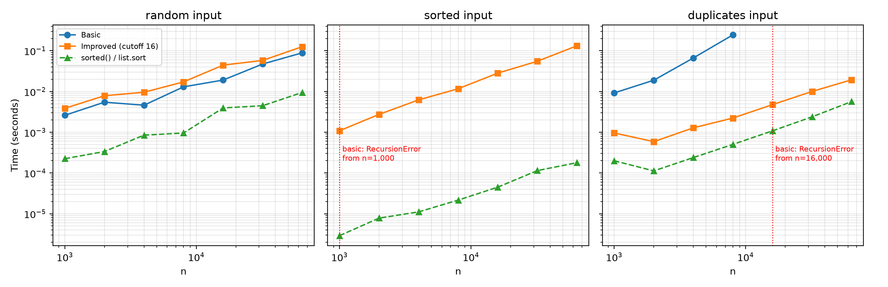
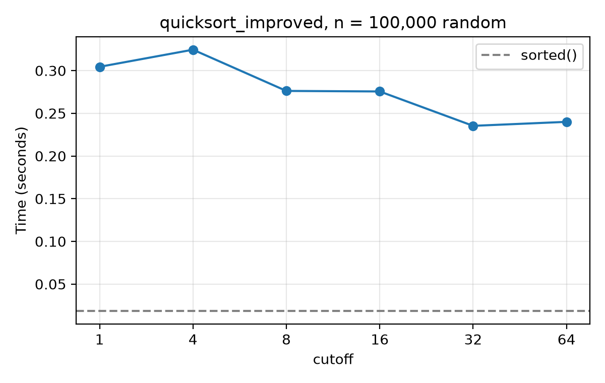

# Assignment 3: Fixing a Slow Quicksort — Report

**AI tool disclosure:** Claude (Anthropic) was used to draft `sorts.py`, `test_sorts.py`, `benchmark_sorts.py` and the first draft of this report. All code was run; both sorts were checked against `sorted()` on 1,200+ random lists per variant plus the required edge cases. 
---

## 1. What I built (Part A)

**`quicksort_basic(a)`**: textbook quicksort, Lomuto partition, last element as pivot, recursing on both sides.

**`quicksort_improved(a, cutoff=16)`**
1. **Random pivot**, so no fixed input (such as sorted data) is always the worst case.
2. **Three-way partition** (less than / equal to / greater than the pivot). The brief only asks for a random pivot, but a random pivot alone does not fix the duplicate-heavy data (see section 3.4), so equal keys are finished in one pass.
3. **Insertion sort** for any part of size ≤ `cutoff`.
4. **Recurse on the smaller part, loop on the larger**, so recursion depth is at most log₂ n whatever the pivots are.

Neither function uses `sorted()` or `list.sort()`; those appear only in the tests and as a timing reference.

## 2. Testing (Part B)

`test_sorts.py` has 14 tests, all passing. Every test runs on `quicksort_basic` and on `quicksort_improved` with cutoffs 16, 1 and 64.

| Requirement | Test |
|---|---|
| ≥ 500 random lists vs `sorted()` | 600 random lists (length 0–200, values −1000 to 1000) and 600 lists of digits 0–9, per variant |
| Empty list, one element | `test_empty`, `test_one_element` (and two elements) |
| All equal | `test_all_equal` |
| Already sorted, reverse sorted | `test_already_sorted`, `test_reverse_sorted` |
| Negative numbers | `test_negative_numbers`, `test_all_negative` |
| Extra | sorts in place and returns `None`; cutoff larger than the list |
| The bug itself | `quicksort_basic` raises `RecursionError` on 5,000 sorted values |
| The fix | `quicksort_improved` sorts 100,000 sorted / reverse-sorted / all-equal / digit-only values with only ~100 frames of recursion headroom |

## 3. Analysis (Part C)

Inputs: random integers (0 to 10⁹), already sorted (0..n−1), and many duplicates (values 0–9). Each time is the median of 3 runs on a fresh copy. Python 3.13 on Windows. The reference column is `list.sort()`, which uses the same algorithm (Timsort) as `sorted()` without the copy. Single readings are noisy (for example basic quicksort on random input took 0.0055 s at n = 2,000 but 0.0046 s at n = 4,000), so read the trends and not individual cells.

### 3.1 Timing tables (seconds)

**Random input**

| n | basic | improved (cutoff 16) | list.sort |
|---:|---:|---:|---:|
| 1,000 | 0.00261 | 0.00386 | 0.00022 |
| 2,000 | 0.00546 | 0.00786 | 0.00034 |
| 4,000 | 0.00460 | 0.00957 | 0.00085 |
| 8,000 | 0.01299 | 0.01717 | 0.00096 |
| 16,000 | 0.01907 | 0.04428 | 0.00395 |
| 32,000 | 0.04720 | 0.05789 | 0.00447 |
| 64,000 | 0.08873 | 0.12563 | 0.00947 |

**Already sorted input**

| n | basic | improved (cutoff 16) | list.sort |
|---:|---:|---:|---:|
| 1,000 | **crash** | 0.00109 | 0.000003 |
| 2,000 | **crash** | 0.00275 | 0.000008 |
| 4,000 | **crash** | 0.00622 | 0.000011 |
| 8,000 | **crash** | 0.01168 | 0.000022 |
| 16,000 | **crash** | 0.02820 | 0.000045 |
| 32,000 | **crash** | 0.05516 | 0.000114 |
| 64,000 | **crash** | 0.13206 | 0.000179 |

**Many duplicates (values 0–9)**

| n | basic | improved (cutoff 16) | list.sort |
|---:|---:|---:|---:|
| 1,000 | 0.00921 | 0.00096 | 0.00020 |
| 2,000 | 0.01888 | 0.00059 | 0.00011 |
| 4,000 | 0.06637 | 0.00128 | 0.00024 |
| 8,000 | 0.24503 | 0.00223 | 0.00050 |
| 16,000 | **crash** | 0.00475 | 0.00108 |
| 32,000 | **crash** | 0.01001 | 0.00238 |
| 64,000 | **crash** | 0.01934 | 0.00565 |

"Crash" means `RecursionError` at Python's default limit (1,000 frames). Basic quicksort crashes on sorted input at **every** size tested, starting at n = 1,000, and on duplicate-heavy input from n = 16,000.

*Figure 1. Running time against n, log-log. The red dotted line marks where `quicksort_basic` starts to crash, so its line stops there.*

**Observations**
- On random data both quicksorts grow roughly like n log n, and basic is about 1.4× **faster** than improved (0.089 s against 0.126 s at n = 64,000). The three-way partition does extra comparisons and swaps per element, so this is the price of robustness.
- On sorted and duplicate data the improved version is the only quicksort that finishes. At n = 8,000 duplicates it is about 110× faster than basic (0.0022 s against 0.245 s).

### 3.2 Explaining the slow case: T(n) = T(n − 1) + Θ(n)

On sorted input the last element is the **largest**, so Lomuto partition moves nothing: the pivot stays last, one part has n − 1 elements and the other has 0. The partition still scans all n − 1 other elements, so

T(n) = T(n − 1) + Θ(n)

Unrolling: T(n) = cn + c(n−1) + … + c·1 = c·n(n+1)/2 = **Θ(n²)**, and the recursion goes n levels deep. The average-case n log n analysis assumes the pivot splits the data roughly evenly, which sorted data never allows.

**Evidence.** I re-ran `quicksort_basic` with the recursion limit raised so it could finish (`basic_deep_recursion.csv`). On sorted input, doubling n multiplied the time by 3.6, 4.0, 4.1, 3.3 (n = 1,000 → 16,000), that is ×3.3 to ×4.1, close to the ×4 that Θ(n²) predicts. Random input scaled by only ×1.9 to ×2.6 per doubling.

| n | sorted (limit raised) | duplicates (limit raised) | random |
|---:|---:|---:|---:|
| 1,000 | 0.049 s | 0.0050 s | 0.0008 s |
| 2,000 | 0.175 s | 0.0229 s | 0.0021 s |
| 4,000 | 0.707 s | 0.0644 s | 0.0040 s |
| 8,000 | 2.929 s | 0.2487 s | 0.0090 s |
| 16,000 | 9.637 s | 0.9905 s | 0.0206 s |

**Duplicates degrade the same way.** `a[j] <= pivot` sends every key equal to the pivot to the left side. With only 10 distinct values, each value ends up as a run of about n/10 equal keys, and each run is peeled off one element per level. That gives recursion depth ≈ n/10, which is why the crash begins between n = 8,000 (depth ≈ 800) and n = 16,000 (depth ≈ 1,600). With the limit raised, duplicate-input time grew by ×2.8 to ×4.6 per doubling, which averages close to ×4 (individual readings are noisy).

### 3.3 Choosing the cutoff (n = 100,000 random values)

Median of 5 runs.

| cutoff | 1 | 4 | 8 | 16 | 32 | 64 | `list.sort` |
|---|---:|---:|---:|---:|---:|---:|---:|
| time (s) | 0.3044 | 0.3245 | 0.2762 | 0.2756 | **0.2353** | 0.2400 | 0.0185 |

*Figure 2. `quicksort_improved` at n = 100,000 for each cutoff.*

**Chosen cutoff: 32.** Using no insertion sort at all (cutoff 1) took 0.304 s; cutoff 32 took 0.235 s, which is 23% faster. Cutoff 64 (0.240 s) is within about 2% of cutoff 32, so the curve flattens around 32 to 64 on this machine. Cutoffs 4 to 16 were clearly slower than 32 (0.324 s, 0.276 s and 0.276 s). Cutoff 4 came out slower than cutoff 1, which is probably noise rather than a real effect. Timings on this machine vary from run to run, so the best cutoff may shift a little between runs; I report the value that won in this run. The default argument in `sorts.py` stays at 16 as the brief specifies.

### 3.4 Why a random pivot alone is not enough

I also tested a random-pivot version that kept the Lomuto partition (`check_lomuto_random.py`), on 10-valued data at n = 64,000. It took **15.7 s**, against **0.020 s** for the three-way partition in `sorts.py`, which is about 770× slower. At n = 16,000 the same comparison was 1.08 s against 0.024 s. A random pivot fixes sorted data but not equal keys: every key equal to the pivot still goes to one side, so each run of equal values is peeled off one element per level. That is why the improved sort uses the three-way partition. On random data the trade-off reverses, with the random-pivot Lomuto version about 1.6× faster (0.087 s against 0.144 s at n = 64,000), which agrees with section 3.1.

### 3.5 Comparison with `sorted()`

At n = 100,000 random values `sorted()` is about **13× faster** than the best improved version (0.0185 s against 0.2353 s). A rough split of that gap:
- **Algorithm.** I counted comparisons with a wrapper class: `sorted()` made 1.53 million and the improved quicksort 3.08 million, so about **2.0×** from the algorithm.
- **Language.** The remaining factor is about 12.7 / 2.0 ≈ **6.3×**, from running in compiled C instead of the Python interpreter. This is a rough estimate, since comparison counts do not capture every cost.
- **Sorted input is a different story.** Timsort detects the existing run and finishes in O(n): 0.000179 s against 0.132 s at n = 64,000, a gap of about 738×, which is almost entirely algorithmic.

## 4. Critical Reflection (Part D)

> **Word limit: 400.** The three answers below are drafts based on my measured results. Rewrite them in your own words and swap in prompt 4 if that is your real experience; you may be asked about them in the viva.

**1. Why did basic quicksort fail on sorted data?** With the last element as pivot, sorted data makes the pivot the maximum every time. The split is n − 1 and 0, giving T(n) = T(n − 1) + Θ(n) = Θ(n²) with recursion depth n. That exceeds Python's 1,000-frame limit, so it crashed from n = 1,000. The average-case analysis assumes the pivot lands somewhere in the middle of the data; real transactions arrive nearly in order, and many equal amounts also send every equal key to one side, so that assumption was broken. With the limit raised, time grew about ×3 to ×4 per doubling, close to the ×4 expected from n².

**2. Why does insertion sort on small parts speed quicksort up?** Big-O hides constant factors. Most recursive calls in quicksort are on tiny sub-lists, and each one pays for a function call, a random number, and a partition. Insertion sort on a few dozen items has no such overhead and makes few comparisons. With no insertion sort (cutoff 1) the sort took 0.304 s; with cutoff 32 it took 0.235 s, about 23% faster. The gain is real but modest in Python, where the interpreter's per-step cost is large, and insertion sort's n² cost would eventually outweigh it at larger cutoffs.

**3. Why is `sorted()` still faster?** About 2.0× is algorithmic: Timsort made 1.53 million comparisons against my 3.08 million, and it is adaptive, finishing sorted input in O(n) (about 738× faster at n = 64,000). The remaining ≈6.3× is the language, since `sorted()` runs in C and mine is interpreted Python. The split is only an estimate, because comparison counts ignore memory and swap costs.

---

## 5. Files submitted

- `sorts.py`: both sorts
- `test_sorts.py`: 14 tests (`python test_sorts.py`)
- `benchmark_sorts.py`: reproduces `timings_sorts.csv`, `basic_deep_recursion.csv`, `cutoff.csv`, `comparisons.csv`, `graph_sizes.png`, `graph_cutoff.png`
- `check_lomuto_random.py`: the one-off check in section 3.4
- This report