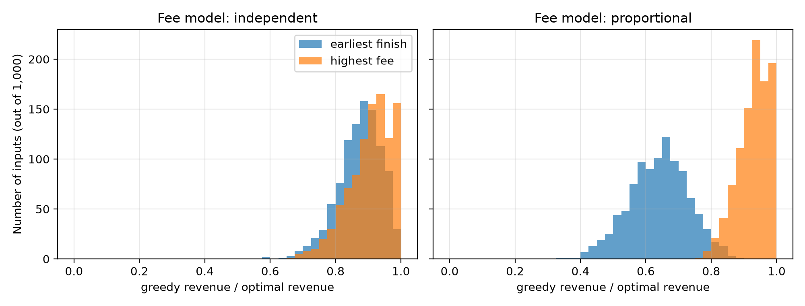

Claude (Anthropic) was used to create `booking.py`, `test_booking.py`, `analyze_booking.py` and first pass of this report. All code was executed and `best_schedule` was tested against `brute_force` with 2500 random inputs and required edge cases.

---

## 1. Building My Solution (Part A)

A request takes the form (start, finish, fee). Two requests can fit if finish_a <= start_b or finish_b <= start_a. All functions return a tuple (total fee, chosen). Chosen is the indices in ascending order of the original list.

`greedy_earliest_finish` takes the requests in order from earliest finish, breaking ties by highest fee. Then any request that starts after the previous accepted is taken.

`greedy_highest_fee` takes the requests in order from highest fee, breaking ties by earliest finish. Any request that fits with all previously accepted requests is taken.

`best_schedule` uses dynamic programming. The requests are sorted by finish time. For each request j define p(j) to be the number of requests that finish by request j starts. This is found by doing a binary search. Define OPT(j) = max(OPT(j-1), fee_j + OPT(p(j))). To find the chosen requests in the optimal solution, backtrack. If fee_j + OPT(p(j)) > OPT(j-1), this request is included and jump to p(j). Otherwise skip.

`brute_force` tries all subsets. Checks whether requests fit based on the definition. It has nothing to do with the DP. It will refuse requests if n > 15.

It is assumed that the requests are valid: start < finish and fee >= 0, otherwise it raises a ValueError. If there was an event of length 0, this depends on the ordering of the requests so the DP won’t have the prefix property (see section 3.2). Therefore I will assume this doesn’t happen.

## 2. Testing (Part B)

There are 20 tests in `test_booking.py`. All tests passed.

Requirement Test

`best_schedule` vs `brute_force`: 1500 random inputs with between 0 and 10 requests. 1500 random inputs with times between 0 and 26 and fees between 0 and 20. 1000 inputs with very small range of times and fees. This means there will be many ties, duplicates and back to back requests. Also ensure that the output is a valid schedule with the correct total fee.

No requests `test_no_requests` all functions return (0, []).

One request `test_one_request`

All overlapping `test_all_overlapping`

None overlapping `test_none_overlapping`

Back to back `test_back_to_back_requests_fit`. The opposite of this is `test_one_minute_overlap_does_not_fit`.

Equal fees: earliest finish is optimal `test_equal_fees_earliest_finish_is_optimal`. 1500 inputs tested against brute force. 500 larger inputs tested against the DP.

Bonus: Example given in brief. Same and zero fees. Unsorted input. Input not altered. Invalid requests refused. Greedy methods always return valid solutions and not better than optimal. Three examples below:

## 3. Analysis (Part C)

### 3.1 Counterexamples

Instance Optimal Earliest Finish Highest Fee

A [(0, 10, 100), (1, 2, 1)] 100 1 100

B [(0, 5, 10), (5, 10, 10), (0, 10, 15)] 20 20 15

C [(0, 10, 100), (0, 5, 60), (5, 10, 60), (1, 2, 1)] 120 61 100

Earliest finish fails in instance A: The earliest finish rule ignores fees. The smallest event (1,2) finishes first and is chosen. This causes the large event (0,10) with fee 100 to be excluded. 1 is therefore returned.

Highest fee fails in instance B: The highest fee rule ignores how much time the events take. The high fee event (15) takes up the whole day meaning the two events with fee 10 aren’t chosen.

Instance C fails both rules. There are four requests. The optimal is to take the two events (0,5) and (5, 10) giving a total of 120. The earliest finish rule takes the smallest event (1,2) which excludes (0,5). Giving a total of 61. The highest fee rule takes the event with the highest fee (100). This excludes both halves. Giving a total of 100.

### 3.2 Why the recurrence is correct

Sort the requests by finish. Let OPT(j) be the maximum total fee for just the first j requests. Consider request j.

If it isn’t chosen then the best we can do is OPT(j-1).

If it is chosen then we know all other requests fit. For any request i < j: finish <= finish of j. And start < finish. So they will fit if finish_i <= start_j. As the list is sorted by finish we know all requests with finish_i <= start_j will be in the first p(j) requests. We know the remaining requests will be a valid solution from the first p(j) requests. This means the maximum we can get is OPT(p(j)). We can always get exactly this amount.

Taking whichever is larger gives us our recurrence. This shows optimal substructure. If the requests in the optimal solution that are within the first p(j) requests aren’t optimal for those requests then we can replace them with a better solution for those requests and get a better solution overall. This is a contradiction. The recurrence only requires values of OPT from smaller prefixes. This means we can fill our table from left to right.

Worked example: Requests from brief in order of finish.

j Request Original Index p(j) OPT(j)

1 (9, 12, 3000) 0 0 3000

2 (12, 14, 2500) 3 1 5500

3 (10, 16, 8000) 1 0 8000

4 (13, 17, 4000) 2 1 8000

5 (16, 18, 2000) 4 3 10000

Backtracking: OPT(5) = 10000 comes from taking request 5 (index 4) and moving to request p(5)=3. OPT(3) = 8000 comes from taking request 3 (index 1) and moving to request p(3)=0. This gives us the indices 1 and 4 which matches the brief.

### 3.3 How Greedy Solutions Compare to Optimal (1000 random inputs of 50 requests)

Each input had 50 requests. Each request had a start time uniformly randomly generated from 0-96. The duration of each request was between 1-12. Two fee models were run:

Independent: Fees were uniformly randomly generated from 1000-10000. This was the main model used in this assignment.

Proportional: Fees were calculated by multiplying the duration of the request by an hourly rate uniformly randomly generated from 500-1000. Long events have higher fees.

The ratio was calculated by dividing the revenue gained by the greedy method by the revenue gained by the DP. The seed was fixed so running `analyze_booking.py` will give the same numbers.

Fee Model Rule Average Ratio Worst Ratio % Greedy Solved

Independent Earliest finish 0.874 0.598 0.2%

Independent Highest fee 0.906 0.670 4.9%

Proportional Earliest finish 0.640 0.335 0.0%

Proportional Highest fee 0.930 0.770 4.8%

Figure 1: A histogram showing how the revenue from greedy compared to optimal for 1000 inputs for each fee model.

### 3.4 Time Complexity

Function Time Reason

`greedy_earliest_finish` O(n log n) Sorted then one pass.

`greedy_highest_fee` O(n²) in worst case. Sorted then each request is checked against up to n accepted requests. Could be improved to O(n log n) by having a sorted data structure of accepted intervals.

`best_schedule` O(n log n) Sorted (O(n log n)), n binary searches for p(j) (O(n log n)), table and backtracking (O(n)).

`brute_force` O(2^n n²). 2^n subsets checked.

All have O(n) space.

## 4. Critical Reflection (Part D)

[400 word limit] Below are my initial answers based on my results. Write them in your own words. For prompt 1, think about your own experiences. You may be asked about these in the viva.

1. Testing and Validity: Passing tests don’t guarantee that the rule will work. All edge cases requested in the brief (no requests, 1 request, no overlapping, back to back, equal fees) all passed for both greedy rules. However, 92.1% of 1000 small random inputs gave the same result as the optimal for `greedy_highest_fee`. This means a small test could easily miss this issue. In my random stream the first failures were at test 2 (earliest finish) and test 3 (highest fee). This was only found because the results were compared to the DP. Only one example is needed to show that a rule is incorrect. No matter how many times you pass the rule, you cannot prove it is correct. An argument must be made to prove it is correct. Such as using the exchange argument or proving the DP has optimal substructure.

2. Should the manager use the simple rule? No. Unless all fees are equal. Using the earliest finish rule gives an average of 87.4% of the optimal revenue when fees are independent of the length. However, when fees increase with length it only gives 64.0% of the optimal. The worst case scenario is 33.5%. It only gave the optimal solution in 0.2% of inputs. The highest fee rule gives better results (90.6% and 93.0%) but still loses out on revenue. `best_schedule` has a time complexity of O(n log n). This is the same order as the greedy rules. This means there is little extra cost to using the DP. It will always give the optimal solution. These results are based off my random model and may differ in real situations.

3. Why does the greedy method work when fees are the same? When fees are the same the revenue is just how many events you can fit. The earliest finish rule will give the most room for later events. If the first event in any optimal solution is swapped for the earliest finishing event then the solution remains valid. This means there will always be an optimal solution starting with the greedy choice. When fees aren’t the same this can cause loss. The earliest finish event may be much cheaper than the event being replaced. See instance A.