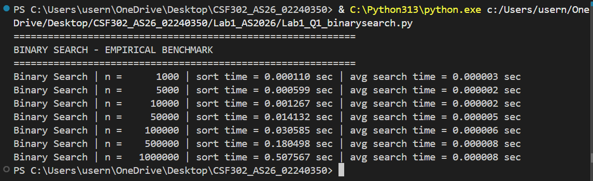
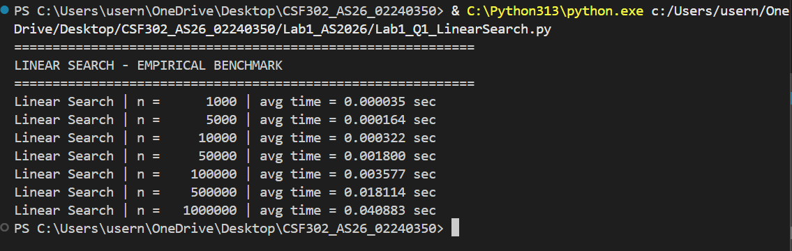
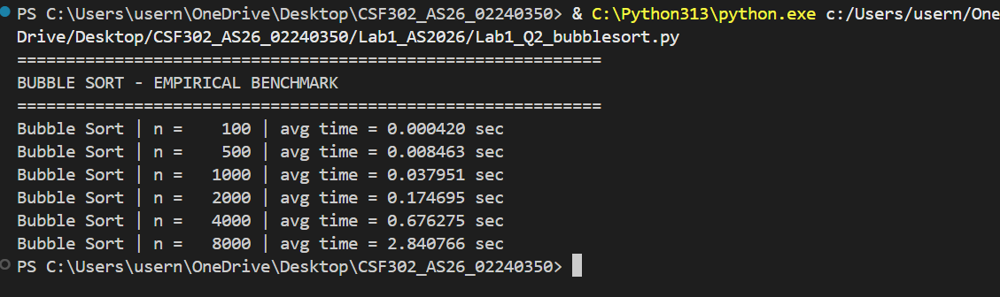
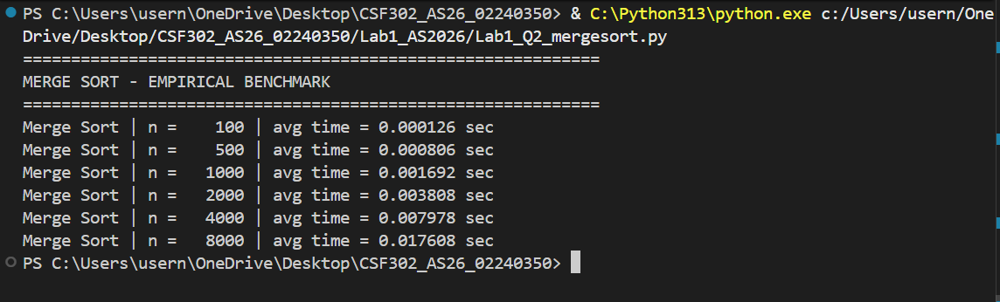
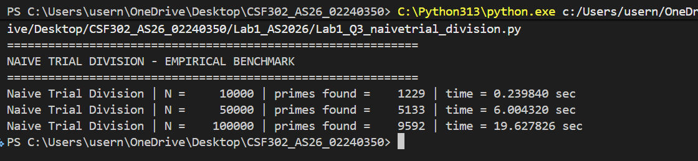
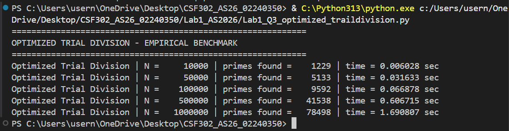
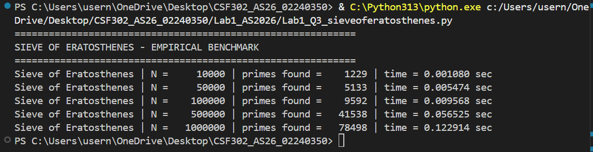

# Lab 1 Screenshots

## Question 1 - Linear Search and Binary Search
This screenshot shows the results of the Linear Search and Binary Search programs. It displays the execution time for different input sizes, which helps compare how both search methods grow as the data size increases.

## Question 2 - Bubble Sort and Merge Sort
This screenshot shows the results of the Bubble Sort and Merge Sort programs. It displays the time taken for each sorting method at different input sizes, making it easier to compare their performance.

## Question 3 - Prime Number Generation Methods
This screenshot shows the output of the three prime generation methods: Naive Trial Division, Optimized Trial Division, and Sieve of Eratosthenes. It shows how long each method takes and how many primes are found, which helps compare their efficiency.

