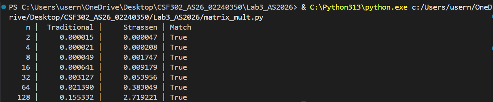
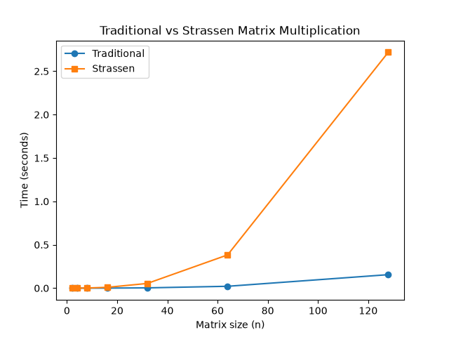
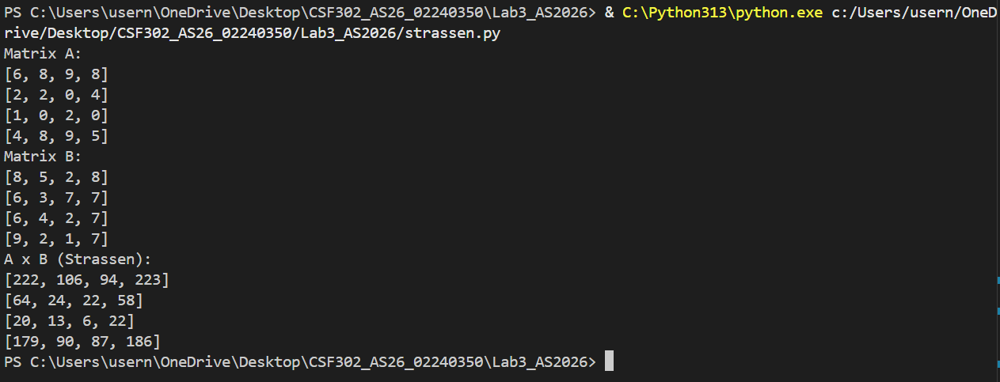
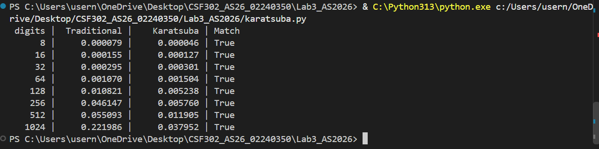
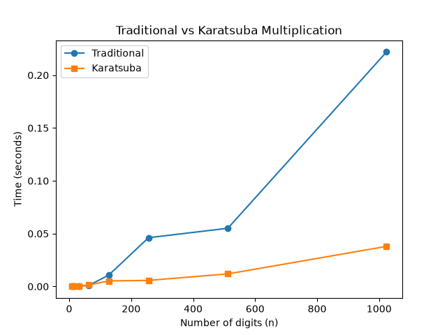
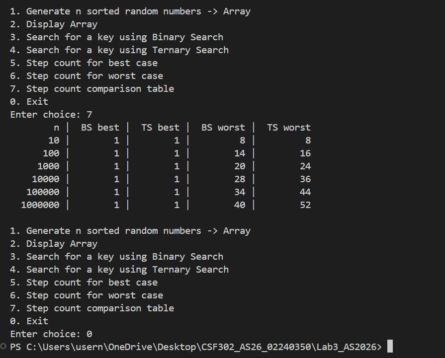
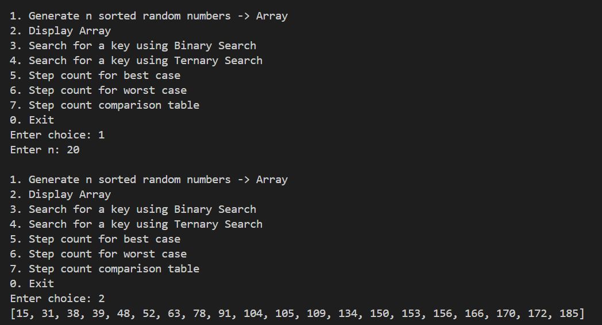
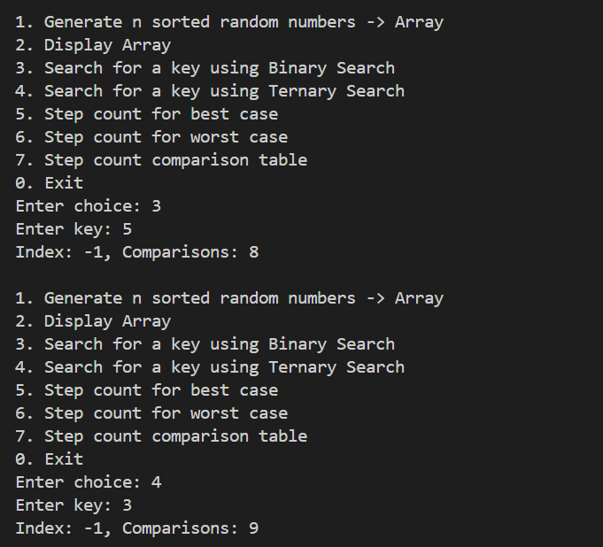
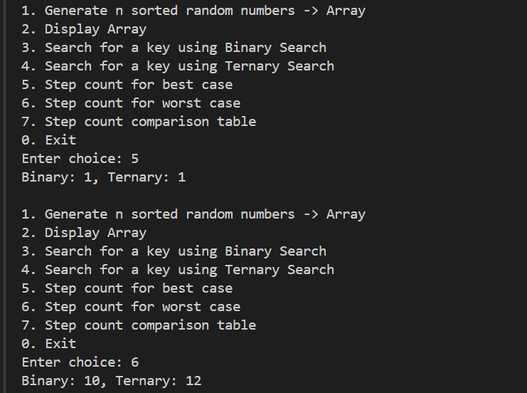
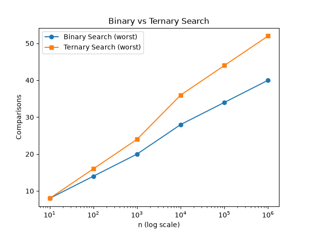

## Q1: Matrix Multiplication — Strassen's vs Traditional

**Objective:**
Multiply two square matrices (n × n) using two algorithms and compare their performance.

**Algorithms:**
1. Traditional Method (triple nested loop, O(n³))
2. Strassen's Algorithm (divide and conquer, 7 multiplications per split)

**Instructions:**
- Make matrix size a power of 2, e.g. 2x2, 4x4, 8x8, 16x16, ... 128x128.
- Input matrices manually or generate randomly.
- Display the resultant matrix from both methods and verify they match.

### Code: `matrix_mult.py`

### Output:

---

### Strassen's Matrix Multiplication (n must be power of 2)

### Code: `strassen.py`
### Output:

---

## Q2: Karatsuba's Algorithm for Large Integer Multiplication

**Objective:**
Multiply two large integers using two algorithms and compare their performance.

**Algorithms:**
1. Traditional Method (grade-school multiplication, O(n²))
2. Karatsuba's Algorithm (divide and conquer, 3 multiplications per split)

**Instructions:**
- Represent integers as strings/digit arrays so sizes can go well beyond native integer limits (e.g. 8, 16, 32, ..., 1024 digits).
- Pad operands to the same length and to the next power of 2 as required by your recursive split.
- Input numbers manually or generate them randomly.
- Verify Karatsuba's result matches the traditional method for every test case.

### Code: `karatsuba.py`
### Output:

**Step/Frequency (Timing) Count Table:**

| Digits | Traditional (s) | Karatsuba (s) | Match |
|--------|------------------|----------------|-------|
| 8      | 0.000079         | 0.000046       | True  |
| 16     | 0.000155         | 0.000127       | True  |
| 32     | 0.000295         | 0.000301       | True  |
| 64     | 0.001070         | 0.001504       | True  |
| 128    | 0.010821         | 0.005238       | True  |
| 256    | 0.046147         | 0.005760       | True  |
| 512    | 0.055093         | 0.011905       | True  |
| 1024   | 0.221986         | 0.037952       | True  |

---

## Q3: Binary Search vs Ternary Search (Menu-Driven Program)

**Objective:**
Write a menu driven program to search for a key in a sorted array of n integers using Binary Search and Ternary Search, and analyze step/frequency counts.

**Menu:**
1. Generate n sorted random numbers → Array
2. Display Array
3. Search for a key using Binary Search
4. Search for a key using Ternary Search
5. Step/frequency count for best case (key present, minimum comparisons)
6. Step/frequency count for worst case (key absent / last comparison)
7. Step/frequency count comparison table across increasing n

**Instructions:**
- Record step/frequency counts (number of comparisons) for each search.
- Compare number of comparisons made by Binary Search vs Ternary Search for the same n, and explain the result in terms of recurrence relations T(n) = T(n/2) + O(1) vs T(n) = T(n/3) + O(1).

### Code: `search.py`
### Output:

**Step/Frequency Count Table (Best case vs Worst case):**

| n       | BS best | TS best | BS worst | TS worst |
|---------|---------|---------|----------|----------|
| 10      | 1       | 1       | 8        | 8        |
| 100     | 1       | 1       | 14       | 16       |
| 1,000   | 1       | 1       | 20       | 24       |
| 10,000  | 1       | 1       | 28       | 36       |
| 100,000 | 1       | 1       | 34       | 44       |
| 1,000,000 | 1     | 1       | 40       | 52       |

### Analysis / Conclusion

The best case for both Binary Search and Ternary Search is 1 comparison — this happens when the key is found at the very first index checked.

In the worst case, **Binary Search consistently makes fewer comparisons than Ternary Search** for the same n (e.g. at n = 1,000,000: Binary = 40 vs Ternary = 52). This follows directly from the recurrence relations:

- Binary Search: T(n) = T(n/2) + O(1) → O(log₂ n)
- Ternary Search: T(n) = T(n/3) + O(2) → O(2·log₃ n)

Even though Ternary Search discards a larger fraction (2/3) of the array at each step compared to Binary Search's 1/2, it pays for **two comparisons per level** instead of one. Since 2·log₃(n) > log₂(n) for all n > 1, Binary Search ends up doing less total work in the worst case, despite Ternary Search's faster theoretical shrink rate per level.

---

## Deliverables Summary

1. **Source code files:** `matrix_mult.py`, `strassen.py`, `karatsuba.py`, `search.py`
2. **Step/frequency count tables:** included above for all three experiments (Q1 timing table, Q2 timing table, Q3 comparison-count table)
3. **Graphs:** `q1_matrix_mult_comparison.png`, `q2_karatsuba_comparison.png`, `q3_search_comparison.png`
4. **Analysis/conclusion:** written as a comment at the end of each source file, and summarized in the Analysis sections above