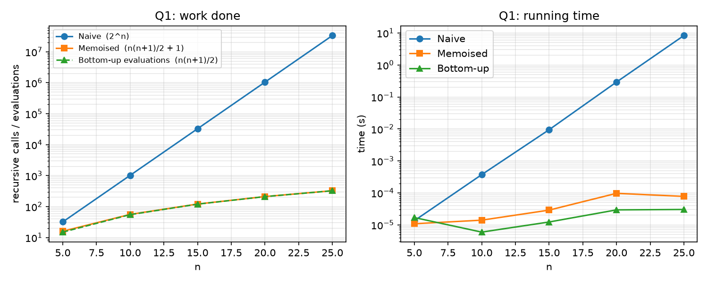
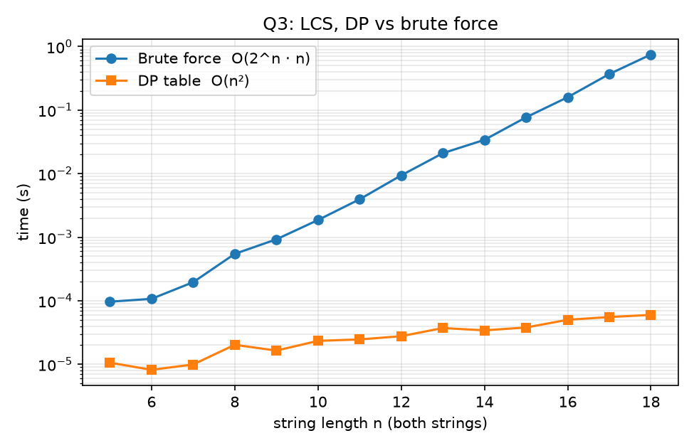

# Lab 6: Dynamic Programming

Files: lab6_q1_rod_cutting.py, lab6_q2_matrix_chain.py, lab6_q3_lcs.py, lab6_q4_optimal_bst.py

The programs have been written in Python 3.11. The programs have been written to run one at a time in pure Python. The actual times may vary depending on the machine, however the trends shall be the same. Each program contains assertions to ensure the correct result for that program.

## Q1: Rod cutting

### 1. Recurrence relation

Given the price table of p[1..10] = 1, 5, 8, 9, 10, 17, 17, 20, 24, 30 (for i > 10, p[i] = 3i), the maximum revenue r(n) can be calculated using:

r(0) = 0 and r(n) = max{ p[i] + r(n-i) } where 1 <= i <= n
Where i is the length of the first piece cut off and the rest is an independent optimisation problem (optimal substructure). The three different versions have varying amounts of calls:
1. Naive recursive - This will make a call to r(n-i) for every i. It therefore makes many repeated calls to the same r(k).
2. Memoisation - Same recurrence relation but for each r(k), we store it once. Any further calls to that r(k) will simply return that value.
3. Tabulation - We fill the array r[1], r[2], ..., r[n], so there is no need to repeat any values. No recursion.
All versions will have the same tiebreaker (smallest first piece), and versions 2 and 3 will also store the first cut (s[j]) so that we can print out the pieces using n -> n-s[n].
### 2. Table of maximum revenue and pieces for n=1 to n=10
n Max Revenue Pieces

1 1 [1]

2 5 [2]
3 8 [3]

4 10 [2,2]
5 13 [2,3]
6 17 [6]
7 18 [1,6]
8 22 [2,6]
9 25 [3.6]
10 30 [10]
Checking manually: n=4 gives a better price of 5 + 5 = 10 compared to 9 for selling as a whole. n=7: 1 + 17 = 18, (2 + 2 + 3 = 5 + 5 + 8 = 18, but the first optimum is given). n=10 gives best price for selling as a whole (30). All versions gave the same revenue for each n (asserted). All lists of pieces sum up to n and the correct revenue.
### 3. Number of recursive calls and runtime for n=5, 10, 15, 20, 25.
We count each call as we enter the function. Calls made for the base case (n=0) and memoised calls will also be included. The tabulation version does not make any recursive calls. The table below shows how many times the inner loop was executed.
n Max Revenue Pieces Naive Memoised Tabulation (no recursion)
5 13 [2,3] 32 16 15
10 30 [10] 1024 56 55
15 45 [15] 32768 121 120
20 60 [10,10] 1048576 211 210
25 75 [10,15] 33554432 326 325
Runtime:
n Naive Memoised Tabulation
5 3.5 µs 3.0 µs 1.2 µs
10 122.9 µs 7.2 µs 3.2 µs
15 3.89 ms 13.3 µs 6.3 µs
20 134.18 ms 21.7 µs 11.0 µs
25 4.691 s 40.6 µs 20.0 µs

For any n >= 10, the maximum revenue is exactly 3n. This is because the best price per length is 3 per unit (p[10]/10 = 3, for i > 10 p[i]=3i). So the optimal solution involves pieces of lengths 10 and above. When n = 20, the program outputs [10,10] instead of [20], as they both give 60 and the tiebreaker is given to the smallest piece first. This is a helpful sanity check.
### 4. Why these values?
Naive: Exactly 2^n calls. T(n) gives us how many calls are made for a length of n. T(0) = 1 and T(n) = 1 + T(n-1) + T(n-2) + ... + T(0). Solving gives us T(n) = 2^n (32, 1024, 32768, 1048576, 33554432). As there is a lot of repetition with the naive approach, we get a large number of calls. For each k < n there are 2^(n-k-1) requests for r(k). When n = 5, the base case (r(0)) is called 16 times. When n = 25, the base case is called 2²⁴ = ~16.8 million times. Each time n increases by 5, the number of calls increases by 32 times. The runtime also increases by about this much (approx 35x).
Memoised: n(n+1)/2 + 1 calls. Only n+1 subproblems to solve (r(0..n)). Each subproblem is solved once. When calculating r(m), a loop of length m is performed. This means the total number of calls is the summation of m from 1 to n. This totals to n(n+1)/2. Adding 1 for the initial call (16, 56, 121, 211, 326). The majority of these calls are memoised and therefore return instantly. Runtime is Θ(n²).
Tabulation: n(n+1)/2 calls. The same number of iterations are performed as the memoised version. No function calls are made. Runtime is Θ(n²), but additional space is used (Θ(n)).
Overall: For n = 25, the naive approach makes ~100,000 x more calls (33.6 million calls vs 326) and takes ~115,000 x longer to run (4.69 s vs 40.6 µs). The tabulation approach is ~2x faster than memoisation (20.0 µs vs 40.6 µs). This is because the tabulation method does not have the overhead of recursion. Tabulation is therefore usually preferred as all subproblems need to be solved anyway. Memoisation is preferred as it only computes the required subproblems.
## Q2: Matrix chain multiplication
### 1. Method
Each matrix A_i has dimensions d[i-1] x d[i]. Let m[i][j] be the minimum number of scalar multiplications required to multiply A_i...A_j. The chain can be split into two parts at k:
m[i][i] = 0, m[i][j] = min{ m[i][k] + m[k+1][j] + d[i-1].d[k].d[j] } for i <= k < j.
This is calculated bottom-up by starting with chains of length 2, then 3 and so on. This ensures that the values of the subproblems exist when required. The best value of k is recorded in s[i][j]. The chain is then reconstructed using recursion. If there is only one matrix then it is simply A_i. Otherwise we have (left right). Runtime is Θ(n³), space is Θ(n²).
To check with brute force (for up to 8 matrices): A separate recursive function generates all complete parenthesisations of the chain. There are Catalan(n-1) different parenthesisations (2, 5, 14, 42, 132, 429 for 3 to 8 matrices). The program will assert that the minimum from the DP matches the minimum from all the parenthesisations and that the parenthesisation printed by the DP is one of those with the same cost as the DP.
The cost for left to right multiplication is the cost of (((A1A2)A3)...An). This is calculated by multiplying the current product (dimensions d[0] x d[k-1]) by A_k. This will cost d[0].d[k-1].d[k]. This is summed from k=2 to n.
### 2. Results
Chain Dimensions Optimal Cost Optimal Order Left to Right Cost Left to Right / Optimal Brute Force (Trees Checked)
CLRS example ⟨30, 35, 15, 5, 10, 20, 25⟩ 15125 ((A1(A2A3))((A4A5)A6)) 40500 2.68x 15125 (42) ✓
small example ⟨5, 4, 6, 2, 7⟩ 158 ((A1(A2A3))A4) 250 1.58x 158 (5) ✓
random 1 ⟨7, 33, 50, 18, 4, 2, 11, 44⟩ 7290 ((A1(A2(A3(A4A5))))(A6A7)) 21952 3.01x 7290 (132) ✓
random 2 ⟨32, 50, 49, 25, 22, 3, 19, 33⟩ 22524 ((A1(A2(A3(A4A5))))(A6A7)) 159200 7.07x 22524 (132) ✓
random 3 ⟨48, 28, 36, 36, 45⟩ 142128 (A1((A2A3)A4)) 188352 1.33x 142128 (5) ✓
random 4 ⟨14, 38, 37, 46⟩ 43512 ((A1A2)A3) 43512 1.00x 43512 (2) ✓
random 5 ⟨18, 44, 41, 45, 7, 29, 23, 7, 25⟩ 40915 (((A1(A2(A3A4)))((A5A6)A7))A8) 93060 2.27x 40915 (429) ✓
CLRS example ⟨30, 35, 15, 5, 10, 20, 25⟩: As expected, the minimal cost is 15125 with optimal order ((A1(A2A3))((A4A5)A6)). Left to right multiplication would require 40500, which is 2.68x more.
⟨5, 4, 6, 2, 7⟩: Minimal cost is 158 with optimal order ((A1(A2A3))A4). Left to right multiplication would require 250, which is 1.58x more.
Five random examples (seed fixed in program) with 3 to 8 matrices and dimensions between 2 and 50: In all cases, the DP solution and brute force solution matched. The cost of left to right multiplication varied between 1.00x (random 4: coincidentally left to right is the optimal) and 7.07x (random 2). The order can make a big difference.
The DP and brute force solutions matched on another 1000 random examples with 1 to 8 matrices (asserted in program).
If there are multiple optimal orders, the one with the smallest k for each level is printed.
## Q3: Longest common subsequence
### 1. LCS Table for X=ABCBDAB and Y=BDCABA
c[i][j] represents the length of the LCS of first i letters of X and first j letters of Y.
c[i][j] = 0 if i=0 or j=0. Else if X[i] == Y[j]: c[i-1][j-1]+1. Else: max(c[i-1][j], c[i][j-1]).
```
-  B  D  C  A  B  A
-    0  0  0  0  0  0  0
A    0  0  0  0  1  1  1
B    0  1  1  1  1  2  2
C    0  1  1  2  2  2  2
B    0  1  1  2  2  3  3
D    0  1  2  2  2  3  3
A    0  1  2  2  3  3  4
B    0  1  2  2  3  4  4
```
So the length of the LCS is 4.
### 2. Reconstructing LCS
Starting from c[m][n], trace backwards. If X[i] == Y[j] then this letter is part of the LCS. Add to front of LCS and move diagonally up-left. Else, move to cell with larger value (preferably up). This gives BCBA. This is a subsequence of both strings (asserted). There is more than one LCS. If we check exhaustively, we see that there are exactly 3 optimal LCS of length 4 (BCAB, BCBA, BDAB). The LCS displayed depends on the tiebreaker.
### 3. Optimised version using 2 rows
Each row i only depends on row i-1 and the populated cells in row i. We can therefore do this with just 2 arrays. Swap arrays once a row has been completed. X and Y are swapped if necessary to keep the rows as short as they can be. This reduces the space complexity to O(min(m,n)). For the example, it returns 4. It agrees with the full table version for 500 random pairs of strings (length 0-25) (asserted). It also asserts that all LCS's reconstructed are indeed common subsequences.
This sacrifices the ability to reconstruct the subsequence as we no longer have access to the table. This can be achieved with extra work (e.g Hirschberg's divide and conquer method), but this is outside the scope of this lab.
### 4. DP vs Brute force for lengths 5 to 18
Brute force: All 2^n subsequences of X are tried. These are then checked against Y. Random strings are generated (using characters A, C, G, T). Both strings have length n. An average of 3 pairs per n. In all cases the length of the LCS agreed with the DP method (asserted).
n DP Table Brute Force Brute / DP
5 3.3 µs 29.5 µs 9x
6 4.4 µs 66.3 µs 15x
7 5.7 µs 115.6 µs 20x
8 7.4 µs 227.6 µs 31x
9 9.1 µs 502.3 µs 55x
10 14.1 µs 1.59 ms 112x
11 14.0 µs 2.46 ms 175x
12 16.2 µs 5.32 ms 328x
13 18.7 µs 9.90 ms 530x
14 20.1 µs 19.96 ms 992x
15 22.7 µs 43.52 ms 1920x
16 25.6 µs 79.35 ms 3102x
17 29.8 µs 183.87 ms 6165x
18 32.4 µs 382.98 ms 11838x

Brute Force: Exponential runtime. For each additional letter in the strings, the runtime roughly doubles. At n=14 it takes 19.96ms, at n=18 it takes 383ms (19x increase). This is because the runtime is ~2^n n. At n=18 it is already checking 262,144 subsequences.
DP: Polynomial runtime. We have (n+1)^2 cells to fill. The runtime increases by ~10x (from 3.3µs to 32µs) as n increases by ~3.6x. However, n² would suggest a 13x increase. This is due to overhead at small n.
At n=18 the DP is ~11800x faster. The difference increases for every additional letter. For a rough estimate, if we ran the brute force algorithm at n=30, it would take ~40 minutes. Whereas the DP would still take ~0.1ms.
### 5. Diff of two text files
Treat each line as a character. Find LCS of the two lists of lines. The lines in the LCS will remain unchanged. Lines from the old file which are not in the LCS will be deleted (-) and lines from the new file which are not in the LCS will be added (+). We use the table generated from the ends of the files to allow us to print the diff in one pass.
We tried it on two small example files (an agenda before and after being edited). The files were:
```
Meeting agenda - algorithms study group
1. Welcome and attendance
2. Review of Lab 5 results
3. Quicksort worst cases
4. Counting sort and radix sort
- 5. Inversions and Kendall tau
- 6. Plan for Lab 6
- 7. Any other business
- Next meeting: Thursday
+ 5. Dynamic programming: rod cutting
+ 6. Dynamic programming: matrix chain
+ 7. Plan for Lab 6
+ 8. Any other business
+ Next meeting: Friday
```
There are 9 lines in the old file and 10 in the new file. 5 lines are unchanged, 4 are deleted and 5 added. Asserts that the old file can be reconstructed exactly by combining the unchanged and deleted lines. The new file can be reconstructed exactly by combining the unchanged and added lines.
Notes:
Edited lines will result in 1 deletion and 1 addition. For example, "6. Plan for Lab 6" became "7. Plan for Lab 6" (number changed). The old line is added as a deletion and the new line is added as an addition. There is no 'changed' category in LCS diffs.
If deletions and additions are equally optimal, the deletion will be printed first. Depending on the tiebreaker, you will get an equally valid diff.
Runtime is O(m.n) for m and n lines. Fine for small files. Real world tools like diff use faster algorithms based on the same concept.
To run on your own files: python lab6_q3_lcs.py diff old.txt new.txt.
## Q4 (Optional): Optimal binary search tree
### 1. Method
We have keys k_1...k_5 which we want to search for with probability p. We also have gaps (unsuccessful searches) with dummy keys d_0...d_5 with probability q. Let e[i][j] be the expected search cost of an optimal tree containing k_i...k_j. Let w[i][j] = (sum of p's) + (sum of q's) of k_i...k_j. If we choose k_r as the root:
e[i][i-1] = q[i-1], e[i][j] = min{ e[i][r-1] + e[r+1][j] + w[i][j] } for i<=r<=j.
The +w[i][j] accounts for all nodes in the range being one level deeper. We store the optimal r in root[i][j]. The cost is calculated as (depth + 1) probability. The root has depth 0. Therefore, the cost is the expected number of nodes to be examined. The program uses exact fractions, so the answer is exactly 2.75.
### 2. Results
```
p = ['0.15', '0.10', '0.05', '0.10', '0.20']
q = ['0.05', '0.10', '0.05', '0.05', '0.05', '0.10']
e[i][j]  (expected cost of an optimal tree on k_i..k_j)
j=0   j=1   j=2   j=3   j=4   j=5
i=1   0.05  0.45  0.90  1.25  1.75  2.75
i=2         0.10  0.40  0.70  1.20  2.00
i=3               0.05  0.25  0.60  1.30
i=4                     0.05  0.30  0.90
i=5                           0.05  0.50
i=6                                 0.10
root[i][j]
j=1   j=2   j=3   j=4   j=5
i=1      1     1     2     2     2
i=2            2     2     2     4
i=3                  3     4     5
i=4                        4     5
i=5                              5

Expected search cost = 2.75

Optimal tree (top = root; first child = left subtree, second = right subtree)

k2
├── k1
│   ├── d0
│   └── d1
└── k5
├── k4
│   ├── k3
│   │   ├── d2
│   │   └── d3
│   └── d4
└── d5

Cost recomputed from the printed tree : 2.75
Cost found by exhaustive search       : 2.75
DP == exhaustive
```

We get an expected search cost of 2.75 which matches the expected value. Our optimal tree is the following:

k₂

├── k₁

└── k₅

├── k₄

└── k₃

Checks:

The cost when calculated from the tree above using Σ (depth + 1)probability over all keys and dummy keys = 2.75.

A brute force approach was taken to ensure the cost was correct by checking all possible trees that can be created with the 5 keys. It was found to be 2.75.

The DP and brute force approach agreed for another 200 random cases.

This is not a balanced tree. The most probable keys k₅ (0.20) and k₁ (0.15) are placed at depth 1. The least probable keys k₄ (0.10) and k₃ (0.05) are placed at depth 2 and 3. The key with the highest probability is not at the root (k₂, 0.10). This is because the root must be chosen such that the subtrees have the best probabilities based on their probability as a whole (including the gaps).

## Notes/Limitations

Run times were taken on a single machine using pure Python. Microsecond times are average times taken over many runs. The slower naive runs (n=25 for Q1, n=18 for brute force Q3) are only run once or a few times.

The 40 minute run time for brute force LCS with n=30 was extrapolated.

The code was run in the following order: python lab6_q1_rod_cutting.py, python lab6_q2_matrix_chain.py, python lab6_q3_lcs.py (this can be run from any folder and will create sample_old.txt and sample_new.txt next to the script if they do not exist), python lab6_q4_optimal_bst.py. Q1 took around 10 seconds due to the naive n=25 run (it was run twice, once to count the number of calls and once to take the time).